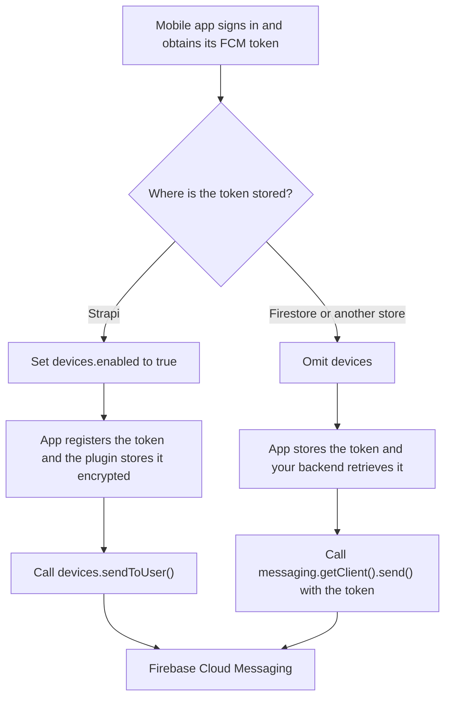

# Firebase Push for Strapi 5

Send Firebase Cloud Messaging (FCM) push notifications from your Strapi backend to one user or a group of users. Use the optional device registry to register, update, and revoke devices. It stores FCM tokens encrypted in Strapi and looks up active devices when your code calls `sendToUser()` or `sendToUsers()`.

Firebase Push reuses the Firebase Admin client already initialized by your project, including the one provided by the recommended Firebase Authentication plugin. If your application already stores device tokens elsewhere, you can pass those tokens directly to the Messaging client.

## 1. Connect Firebase Messaging

Install Firebase Push in your Strapi project.

```bash
npm install @3xweb/strapi-plugin-firebase-push
```

### Zero Configuration (recommended)

Use the community [Firebase Authentication plugin](https://community.strapi.io/marketplace/strapi-plugin-firebase-authentication) (`strapi-plugin-firebase-authentication`). Set it up in your Strapi project first. After successful initialization, version 1.7.1 attaches the Firebase Admin SDK to `strapi.firebase`. Firebase Push automatically uses the SDK’s `strapi.firebase.messaging()` method. Enable Firebase Push in `config/plugins.ts` without a `config` object.

```ts
export default () => ({
  "firebase-push": { enabled: true },
});
```

Zero Configuration gives your backend a Messaging client. To have Firebase Push store device tokens, complete step 2 as well.

### Use your own Firebase Admin SDK integration

If your application or another provider initializes a Firebase Admin app on the server, Firebase Push can reuse that app through the Firebase Admin SDK registry. The app must be initialized before the first call to `getClient()`. Set the expected Firebase project ID. Add `appName` when there are multiple registered apps and use the exact name passed to Firebase Admin at initialization.

```ts
export default ({ env }) => ({
  "firebase-push": {
    enabled: true,
    config: {
      projectId: env("FCM_PROJECT_ID"),
      appName: "notifications", // Omit this if only one Admin app is registered.
    },
  },
});
```

This is the fallback when the recommended provider has no ready client. If it has a ready client for a different configured project, Firebase Push rejects the mismatch. Firebase emulator configuration is rejected. You can also supply an optional `isProjectVerified(strapi)` callback for an application-specific verification check.

In either setup, get the native Firebase Admin Messaging client from server-side code.

```js
const messaging = strapi.plugin("firebase-push").service("messaging").getClient();
```

## 2. Choose where to store device tokens

Firebase Authentication signs users in. The mobile app obtains its own FCM registration token after sign-in and sends it to the storage destination your application uses. Update the stored token whenever the mobile SDK reports a refresh.



| Token storage | Plugin configuration | Server-side dispatch |
| --- | --- | --- |
| **Strapi device registry** | Set `devices.enabled: true` and configure the project ID, keys, and scope resolver described below. Grant the authenticated role the **Register** and **Revoke** actions. | The app registers the FCM token through the plugin. The plugin stores it encrypted in `firebase_push_devices`. Call `devices.sendToUser()` with the authorized tenant and Strapi user ID. |
| **Existing store, such as Cloud Firestore** | Omit `devices` or keep `devices.enabled: false`. Use either Messaging setup in step 1. | Your application reads the authorized device token from its store and passes it to `messaging.getClient().send()`. |

Omitting `devices` leaves the Strapi registry disabled. The plugin has no Firestore collection setting. When using Firestore, your application owns the collection path, user-to-device mapping, and token lookups.

### Mobile app integration

With the Strapi registry enabled, send `POST /api/firebase-push/devices` with the Strapi session JWT as a bearer token and a JSON body containing `installationId` and `token`. Use the same installation ID when refreshing the token. On logout, call `DELETE /api/firebase-push/devices/:installationId` with the JWT before clearing the session. The route details and storage settings are below.

### Configure encrypted storage in Strapi

Keep `devices.enabled` omitted or false to retain the original Messaging-only behavior. The plugin declares a private content type and guards the device routes even when the registry is disabled. The device registry and `sendToUser()` require PostgreSQL or SQLite. **MySQL is not supported for these features.** Strapi projects using MySQL can still use the standalone Messaging service. The registry uses unique database constraints and an atomic conditional update to handle concurrent requests.

Use this full `config/plugins.ts` example when you want the plugin to store tokens. The `projectId` and `devices` settings are required for this option, including when you use the recommended Firebase Authentication provider. If your fallback Admin app is named, place `appName` alongside `projectId`.

```ts
export default ({ env }) => ({
  "firebase-push": {
    enabled: true,
    config: {
      projectId: env("FCM_PROJECT_ID"),
      devices: {
        enabled: true,
        hashKey: env("FCM_DEVICE_HASH_KEY"),
        encryptionKey: env("FCM_DEVICE_ENCRYPTION_KEY"),
        encryptionKeyId: env("FCM_DEVICE_ENCRYPTION_KEY_ID"),
        resolveScope: (ctx) => {
          // Your server sets this state after checking access and consent.
          return ctx.state.verifiedPushScope;
        },
      },
    },
  },
});
```

Set `FCM_PROJECT_ID` to your Firebase project ID. Generate two distinct keys as described below and assign an encryption key ID, such as `v1`. The scope resolver must return `{ tenantId, projectId }` for an authorized registration or revocation.

The host must implement that authorization, or perform the same checks directly inside its scope resolver. In a single-tenant application, use a stable server-defined tenant identifier. Derive tenant membership and the project from trusted application context. The registry uses the top-level `projectId` and the owner exclusively from the authenticated Users & Permissions session. Request data cannot select the owner, tenant or project. In Strapi Admin, go to **Settings → Users & Permissions → Roles → Authenticated** and enable **Register** and **Revoke** under **Firebase Push** for the roles that should manage their own devices. Keep both permissions disabled for the **Public** role.

- `POST /api/firebase-push/devices` accepts `{ installationId, token }` and returns 204. Repetition does not create a second record. The same owner can update a token or explicitly re-register a revoked installation. Another owner cannot take a registered installation or token in the same tenant and project.
- `DELETE /api/firebase-push/devices/:installationId` revokes only the authenticated owner's installation and returns 204, including when there is nothing to revoke. It clears the ciphertext and retains the digests as ownership markers. Logout flows should revoke while the session is still valid. A request which has already handed a push to Firebase cannot be recalled by a subsequent revocation.

Use two distinct 32-byte random keys encoded in standard Base64. Store them in the host secret manager. Keep `hashKey` stable to preserve HMAC-based deduplication across encryption key rotations. Use a new `encryptionKeyId` with each new AES-256-GCM key, and retain old keys by ID in the optional `decryptionKeys` object during rotation. Subsequent registration encrypts with the current key. Keep the old key until remaining devices have registered again or been explicitly migrated. The plugin performs no bulk key migration and neither plaintext tokens nor ciphertext are returned by the routes.

## Programmatic dispatch

### Send to registered devices

Enable the device registry on PostgreSQL or SQLite and call the service from a Strapi controller, service, or scheduled job.

```js
async function notifyReportReady(strapi, { tenantId, userId }) {
  const devices = strapi.plugin("firebase-push").service("devices");

  return devices.sendToUser({
    tenantId,
    userId,
    message: {
      notification: { title: "Update", body: "Your report is ready." },
      data: { type: "report.ready" },
    },
  });
}
```

- `tenantId` matches the trusted scope used during registration. `userId` is the recipient's Strapi Users & Permissions ID.
- The caller authorizes the recipient and checks current notification consent before calling the service. The payload accepts Firebase multicast options such as `notification`, `data`, and platform-specific settings. The service determines the devices from the registry.
- The result is `{ accepted, failed }` and counts devices. An FCM acceptance confirms submission. It does not confirm delivery to the device. If there are no active devices for the recipient, both counts are zero.

### Send to multiple users

Call `sendToUsers()` to send the same message to up to 500 user IDs in one tenant. The method deduplicates user IDs and returns the combined `{ accepted, failed }` device counts. Your application must authorize every recipient and check current consent before calling it.

```js
const devices = strapi.plugin("firebase-push").service("devices");
const result = await devices.sendToUsers({
  tenantId: authorizedTenantId,
  userIds: authorizedUserIds,
  message: { notification: { title: "Update", body: "A new report is available." } },
});
```

### Use the native Firebase client

For an application that already manages its own device tokens, call the server-side Messaging service directly.

```js
const messaging = strapi.plugin("firebase-push").service("messaging").getClient();
const messageId = await messaging.send({
  token: authorizedDeviceToken,
  notification: { title: "Update", body: "Your report is ready." },
});
```

### Schedule or call from another system

For scheduled delivery, have a Strapi cron task call your application service. For an external workflow, expose an authenticated route in your application and authorize dispatch and recipient scope on the server before calling the plugin. The plugin exposes dispatch through server-side services. Its HTTP routes are for authenticated device registration and revocation.

## Migrating existing integrations

Keep existing endpoints and request contracts in host adapters when clients depend on them. Translate a path-based installation ID or a differently named body field to `installationId`. Continue validating host-specific notification permission, opt-in, account status, platform and project. Existing device data is not imported by enabling the plugin. Prefer re-registration through the authenticated flow or design a separate, authorized migration from the host's encrypted storage. Keep the existing transport until local tests cover registration, revocation and a simulated delivery.

Requires Strapi 5, Firebase Admin 13.3+ in major 13 and Node.js 20 or later, subject to the application's Strapi version. Run `npm test` locally with synthetic data and mocked transport.
